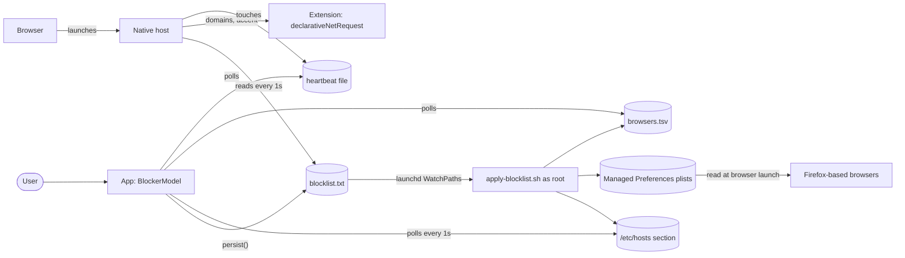

# Overview

## Purpose

Disciplined blocks a list of sites in three independent ways, so that one being bypassed (a proxy, DNS-over-HTTPS, a browser with its own resolver) doesn't unblock the site. This doc is the map. Each part has its own doc, linked below.

## Components

| Process | Runs as | Code | Doc |
| --- | --- | --- | --- |
| The app (window, Settings, menu bar item) | The user | `Sources/` (`DisciplinedApp`, `BlockerModel`, views) | [app-state.md](app-state.md) |
| The root helper | root, started by launchd | `Resources/apply-blocklist.sh`, installed by `BlockerHelper` | [root-helper.md](root-helper.md) |
| The browser extension | Inside each browser | `Extension/`, `FirefoxExtension/manifest.json`, packaged by `BrowserExtension` | [browser-extension.md](browser-extension.md) |
| The native messaging host | The user, started by the browser | The app's own binary in host mode (`NativeHost`) | [native-messaging-host.md](native-messaging-host.md) |

`Entry.main()` decides which of the two app-binary roles a launch is: the native host if the browser's launch arguments say so, otherwise the UI.

## How it works

1. The user edits the list or flips the toggle. `BlockerModel.persist()` saves `domains` and `isBlocking` to UserDefaults, then writes `blocklist.txt`. It writes the domains while blocking is on, and an empty file while it's off.
2. launchd notices the change and runs the helper script as root. The script rewrites its section of `/etc/hosts` and the policy file of each Firefox-based browser, and records those browsers in `browsers.tsv`.
3. Any browser with the extension connected has the native host running. The host reads `blocklist.txt` every second and sends the extension the list whenever it changes. The extension replaces its redirect rule and redirects open tabs.
4. The app polls once a second and reads back what was applied (the hosts section, `browsers.tsv` and the heartbeats) to show its status.

The app never talks to the helper or the host directly. Everything goes through files, which is why the app needs no password after setup and the host works while the app's window is closed.

## Files on disk

| Path | Written by | Read by |
| --- | --- | --- |
| `~/Library/Application Support/Disciplined/blocklist.txt` | App (`BlockerHelper.writeBlocklist`) | Helper script, native host |
| `~/Library/Application Support/Disciplined/Chrome Extension/` | App (`BrowserExtension.install`, a mirror of the bundled `Extension/`) | Chromium browsers, loaded unpacked by the user |
| `~/Library/Application Support/Disciplined/Firefox Extension/` | App (staging folder for the `.xpi`) | App only |
| `~/Library/Application Support/Disciplined/Disciplined.xpi` | App | Firefox-based browsers in extension mode, through their policy |
| `/Library/LaunchDaemons/com.disciplined.blocker.plist` | App, once, as admin (`BlockerHelper.install`) | launchd |
| `/Library/Application Support/Disciplined/apply-blocklist.sh` | App, once, as admin | launchd; the app compares it with the bundled copy |
| `/Library/Application Support/Disciplined/browsers.tsv` | Helper script | App (`BrowserExtension.geckoBrowsers()`) |
| `/etc/hosts`, between `# >>> Disciplined blocklist >>>` and `# <<< Disciplined blocklist <<<` | Helper script | System resolver; app (`BlockerHelper.appliedHosts()`) |
| `/Library/Managed Preferences/<bundle-id>.plist` | Helper script | That browser, at launch; the app checks its date |
| `~/Library/Application Support/<browser folder>/NativeMessagingHosts/com.disciplined.mac.json` | App (`BrowserExtension.writeHostManifests`) | Browsers, to find the native host |
| `~/Library/Caches/com.disciplined.mac/extension-heartbeat-<key>` | Native host | App (`BrowserExtension.isConnected`) |
| `~/Library/Caches/com.disciplined.mac/SiteIcons/<source>/<sha256>` | App (`Favicon`) | App |

## Defaults keys

All live in the app's domain, `com.disciplined.mac`.

| Key | Meaning | Owner |
| --- | --- | --- |
| `domains` | The list, newest first. This is the source of truth; `blocklist.txt` is derived from it. | `BlockerModel` |
| `isBlocking` | The on/off toggle | `BlockerModel` |
| `appTheme` | Accent color choice | `AppTheme` ([accent-color.md](accent-color.md)) |
| `appThemeColors` | That choice resolved to `#rrggbb` for light and dark mode, for the native host | `AppTheme` |
| `hideSiteList`, `authenticateToShowSites` | Site list privacy settings | `SiteListPrivacy` ([privacy.md](privacy.md)) |
| `showSiteIcons`, `siteIconSource` | Favicon settings | `Favicon` ([privacy.md](privacy.md)) |
| `AppleLanguages` | The app's language override | `AppLanguage` ([localization.md](localization.md)) |

## The app's scenes

`DisciplinedApp` has three:

- **The main window.** `ContentView` shows `SetupView` until the helper is installed, then `MainView`.
- **Settings.**
- **A `MenuBarExtra`.** It's always present while the app runs. It shows the status, the toggle, and Open/Settings/Quit. Its icon (`MenuBarIcon`) is filled while the status is `active`.

The app menu also has "Remove Blocker Helper…".

## Related

- Cross-file invariants and development gotchas: [`CLAUDE.md`](../../CLAUDE.md#invariants-that-span-files).
- [testing.md](testing.md) covers how each part is tested.
